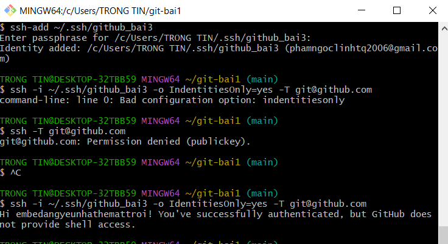

# Bai 3: Cau hinh xac thuc SSH va day du an len GitHub

## Muc tieu

Tao khoa SSH Ed25519, cau hinh repository local ket noi voi GitHub bang SSH va day lich su commit len remote repository.

## Thong tin cau hinh

- Thu muc bai tap: `homework/session_04/ex3`
- Khoa SSH public: `C:\Users\TRONG TIN\.ssh\github_bai3.pub`
- Remote SSH du kien: `git@github.com:phamngoclinhtq2006/git-bai1.git`

Khong nop private key. Chi nop public key neu can them vao GitHub.

## Public key can them vao GitHub

```text
ssh-ed25519 AAAAC3NzaC1lZDI1NTE5AAAAIFkvqyMRtQnAP/cX5sGFN+ZjuYsE+cfqGMLcf/BrlXt8 phamngoclinhtq2006@gmail.com
```

## Cac lenh da thuc hien

### 1. Tao thu muc bai tap

```bash
mkdir -p homework/session_04/ex3
cd homework/session_04/ex3
```

### 2. Khoi tao Git repository

```bash
git init -b main
```

### 3. Cau hinh danh tinh local

```bash
git config --local user.name "TRONG TIN"
git config --local user.email "trongtin@example.com"
```

### 4. Tao khoa SSH Ed25519

May da co san khoa Ed25519 tai `C:\Users\TRONG TIN\.ssh\github_bai3`

Neu can tao moi, dung lenh:

```bash
ssh-keygen -t ed25519 -C "phamngoclinhtq2006@gmail.com" -f ~/.ssh/github_bai3
```

### 5. Them public key vao GitHub

Vao GitHub:

```text
Settings -> SSH and GPG keys -> New SSH key
```

Dan noi dung file public key `github_bai3.pub` vao GitHub.

### 6. Kiem tra ket noi SSH toi GitHub

```bash
ssh -T git@github.com
```

Hoac chi dinh dung khoa:

```bash
ssh -T -i ~/.ssh/github_bai3 git@github.com
```

### 7. Cau hinh remote bang SSH

```bash
git remote add origin git@github.com:phamngoclinhtq2006/git-bai1.git
```

### 8. Day code len GitHub

```bash
git add .
git commit -m "Add SSH GitHub setup report"
git push -u origin main
```

## Lenh kiem tra

### Kiem tra remote URL

```bash
git remote -v
```

Ket qua thuc te:

```text
origin  git@github.com:phamngoclinhtq2006/git-bai1.git (fetch)
origin  git@github.com:phamngoclinhtq2006/git-bai1.git (push)
```

### Kiem tra SSH

```bash
ssh -T git@github.com
```

Ket qua mong doi sau khi them public key vao GitHub:

```text
Hi phamngoclinhtq2006! You've successfully authenticated, but GitHub does not provide shell access.
```

Ket qua thuc te tren may hien tai:


### Kiem tra commit local

```bash
git log --oneline
```

Ket qua:

```text
d32ee30 Add SSH GitHub setup report
```
